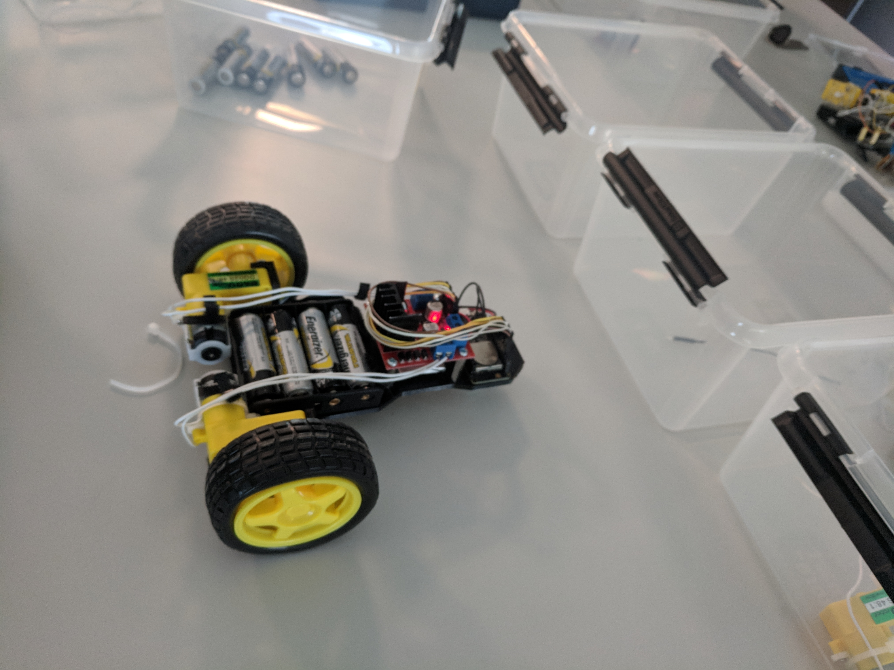

# esp32car
during my first year at highschool we where challenged to make a radiocontrolled car using a esp32 and some servos as a group project. The esp32 had code already written on it in some arduiono editor and when connecting to the wifi network created by the esp32 one would be presented with a page where there where various hyperlinks to press that would allow you to drive the car in various directions. 

The problem was that one needed to wait for the hyperlink to load a new page before inputting their next action making it hard to control (Especially since the network created by the esp was very slow). 

This "website" was my first attempt at actually coding(i had only done html, css and scratch before) and all it did was listen for wasd keypresses and send the requests to the esp32. It did allow us to control our car better than most of the teams and many of my class mates started asking if they could have a copy of the code, we did pretty well as i remember and it was a very fun assignment.

pictured is the car, the physical aspects(the wiring the 3d printing of some parts) where done by the rest of my group.

NOTE: this code would have been written in 2018, when i was when i was 16. The code reflects my age and maturity at that time :)
